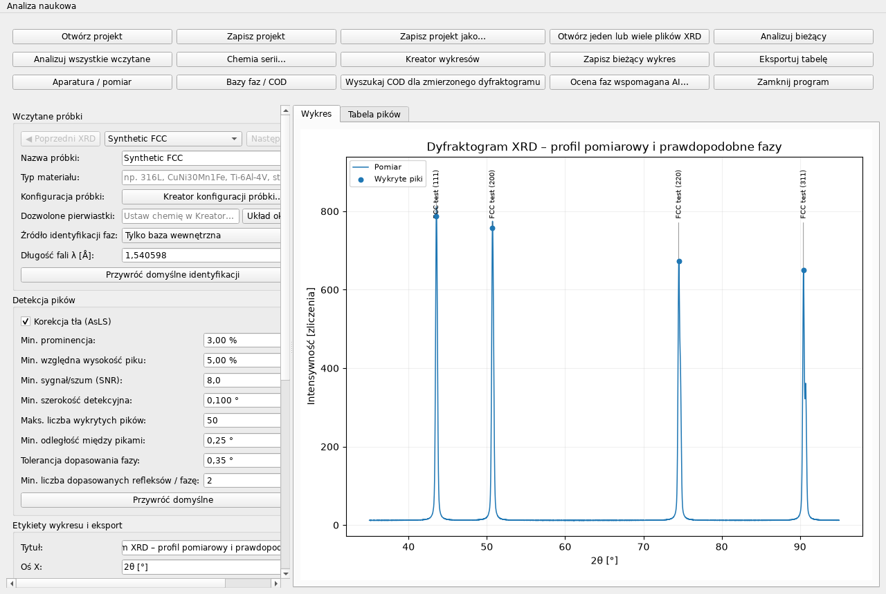

# XRD Analyzer 20.3.5.1 — X-ray Diffraction Analysis

[](LICENSE)

**Research-oriented desktop application for X-ray diffraction (XRD) analysis**, peak detection, crystalline-phase screening using the Crystallography Open Database (COD), scientific profile analysis, and publication-quality plots. The primary interface is in Polish.



## What is XRD and what does the application do?

X-ray diffraction records diffracted X-ray intensity versus scattering angle **2θ**. Peak positions and shapes help investigate crystalline structures and phase composition; interpretation depends on specimen and measurement conditions.

- Import, organize and plot XRD scans; inspect diffraction peaks and their parameters.
- Correct background, detect peaks, calibrate measurement geometry and compare scans.
- Identify **candidate** crystalline phases using a built-in catalogue or an external **COD SQLite `.db3`** database; calculate Bragg reflection positions from structure metadata using Gemmi. COD screening does **not** calculate a full experimental intensity pattern and is **not** full Rietveld refinement.
- Analyse fitted profiles, instrumental broadening, estimate crystallite size via Scherrer and size/strain trends using Williamson–Hall when assumptions are met; support sin²ψ workflows and experimental advanced models.
- Recognize possible Cu Kα₁/Kα₂ peak doublets when both wavelengths are known, without deleting measured peaks.
- Produce publication-oriented diffractogram, profile-fit, comparison and analysis figures; export tabular peak data and source metadata.
- Save and reopen `.xrdproj` projects; maintain COD peak assignment provenance in recent releases.

## Supported formats

| Purpose | Formats |
| --- | --- |
| Scan import | `.udf`, Philips/PANalytical V3RD `.rd`, `.xrdml`, selected `.xml`, powder-profile `.cif`, delimited `.csv`, `.txt`, `.dat`, `.asc` |
| Projects | `.xrdproj`, supported legacy `.json` projects |
| COD database | SQLite `.db3`, `.sqlite`, `.sqlite3`, `.db` (compatible schema required) |
| Figure export | PNG, TIFF, PDF, SVG, EPS |
| Results export | CSV, XLSX |

**Not every proprietary XRD binary version or CIF structure file is a valid scan**. The `.rd` importer was validated against a V3RD silicon scan; support for other RD versions is not established. Powder CIF must contain intensity data. See [opis badań i formatów](OPIS_BADAN_XRD_I_FORMATY_PL.md).

## Installation — Windows

1. Download this source repository (Code → Download ZIP) or clone it.
2. Unpack it into a **new directory**. Do not overwrite your verified research installation.
3. Run `START_XRD_ANALYZER.bat`. It creates `.venv` and installs the libraries in `requirements.txt`; Python 3.13 is preferred.
4. Open a diffraction scan using **Otwórz jeden lub wiele plików XRD**.
5. For COD: **Bazy faz → COD .db3 → Wczytaj bazę COD .db3**; search by element/name or choose **Wyszukaj COD dla zmierzonego dyfraktogramu**.

The full COD database is **not included**. Download the source dataset from [Crystallography Open Database](https://www.crystallography.net/cod/). SQLite COD datasets compatible with third-party tools can be found via [Profex](https://www.profex-xrd.org/download/); compatibility of a given `.db3` schema must be checked. The software also supports selected COD download/import workflows. COD attribution and original structure references should be respected.

## Scientific validation and limitations

The maintainer validated **silicon phase-screening** against COD record `2104737` on Windows: 8/8 selected measured reflections matched the candidate structure, **RMS Δ2θ ≈ 0.0129°**, cell parameter **a ≈ 5.431 Å**; peak assignments survived saving and reopening a project. This checks a specific reference scan, **not** performance on unknown mixtures, phase-quantification accuracy, or independent metrology certification. It does not prove full application coverage or general results for other materials.

This repository does not distribute the private/reference silicon `.rd` scan. Its absence causes two optional real-data tests to be skipped. The remaining tests primarily use synthetic datasets and must be run in an appropriate desktop Python environment. The GUI has not been independently revalidated on all operating systems after the last update.

**Do not treat phase ranking percentages as calibrated probabilities.** Visual/manual review, wavelength and instrument calibration, error estimates, selection of correct data, and checking original literature are essential before publication.

## Testing

```powershell
py -3.13 -m venv .venv
.venv\Scripts\python.exe -m pip install -r requirements.txt pytest
$env:QT_QPA_PLATFORM = "offscreen"
.venv\Scripts\python.exe -m unittest discover -s tests -v
```

## Project files, licensing and provenance

The repository intentionally excludes laboratory measurements, private `.xrdproj` projects, historical logs containing absolute user paths, full COD mirrors, and confidential data. Synthetic GUI screenshot and example configuration are included solely for illustration.

Original application source code is published under **GNU GPL-3.0-only**; see [LICENSE](LICENSE). Third-party packages, instrument-file formats, COD records and other data retain their own licensing. See [THIRD_PARTY_COMPONENTS.md](THIRD_PARTY_COMPONENTS.md) and [AI_ASSISTED_DEVELOPMENT.md](AI_ASSISTED_DEVELOPMENT.md).

Development was **AI-assisted**, with the human maintainer setting requirements and validating research workflows. Contributions and reproducible bug reports are welcome.

[Opis po polsku](README_PL.md) · [COD Offline](COD_OFFLINE_INSTRUKCJA_PL.md) · [Program status](RELEASE_STATUS.md)
